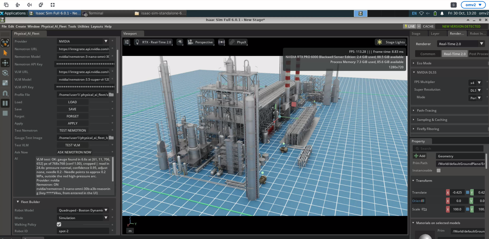
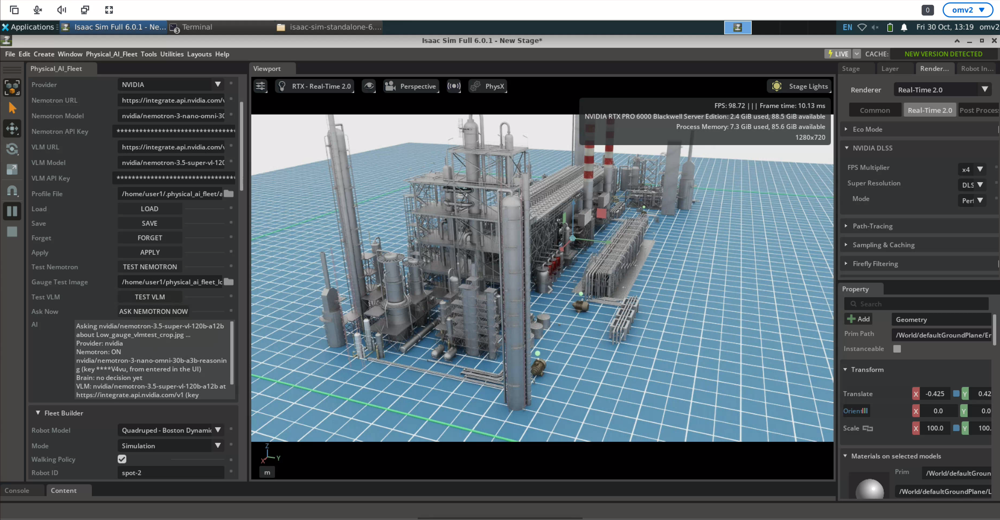
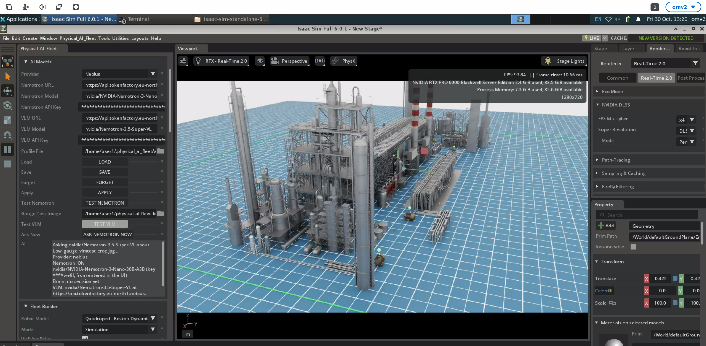
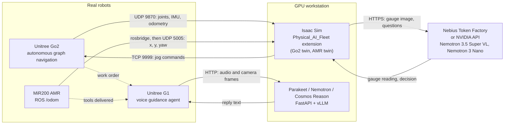

# Multi_Agent_Physical_AI_Fleet_Twin

A fleet of three real robots (a Unitree Go2, a MiR200 AMR and a Unitree G1) working one industrial maintenance scenario, with digital twins of the robots running in NVIDIA Isaac Sim. The Go2 inspects and finds a fault, an AMR brings the tools, and the G1 goes to the fault with the worker and guides the repair by voice.

Inspection and guidance run on **NVIDIA open models** (Nemotron 3.5 Super VL, Nemotron 3 Nano, Nemotron Nano 9B, Parakeet, Cosmos Reason). The gauge inspection runs **29% faster on Nebius Token Factory** than on the NVIDIA API in our benchmark ([section 2](#2-built-with-nvidia-open-models-and-nebius-token-factory)).

---

## 1. The scenario

| Step | Robot | What happens |
|---|---|---|
| 1. Inspect | **Unitree Go2** | Walks a mapped site on its own, goes to any waypoint node by number, and raises a work order when it finds a fault |
| 2. Bring tools | **MiR200 AMR** | Carries the tools to the site. Its real position is mirrored live into Isaac Sim (digital twin) |
| 3. Guide the repair | **Unitree G1** | Goes to the fault location with the worker, reads the written SOP step by step by voice, identifies objects with its camera, and high-fives when the repair is done |
| Fleet view | **Isaac Sim** | The `Physical_AI_Fleet` extension shows the robots as digital twins, reads plant gauges with a vision language model, lets you jog the real Go2, mark no-go zones and plan inspection routes |

---

## 2. Built with NVIDIA open models and Nebius Token Factory

### NVIDIA open models in the fleet

| Model | Where it runs | What it does |
|---|---|---|
| `nvidia/Nemotron-3.5-Super-VL` (120B-A12B) | Isaac Sim extension, gauge inspection | Finds the pressure gauge in the robot's camera frame, then reads the needle and decides normal / low / high |
| `nvidia/NVIDIA-Nemotron-3-Nano-30B-A3B` | Isaac Sim extension, fleet "brain" | Turns inspection results into decisions and answers operator questions ("Ask Nemotron") |
| `nvidia/parakeet-tdt-0.6b-v2` | G1 voice agent | Speech to text from the G1 microphone array |
| `nvidia/NVIDIA-Nemotron-Nano-9B-v2` | G1 voice agent | Answers only from the written SOPs, one step at a time, and refuses anything outside them |
| `nvidia/Cosmos-Reason1-7B` | G1 vision Q&A | Answers "what is this?" on live frames from the G1 head camera |
| NVIDIA Isaac Sim 6.0 + Omniverse | Fleet view | Digital twins of the robots on an oil and gas plant scene |

### Nebius Token Factory: one dropdown, same code

The `Physical_AI_Fleet` extension has an **AI Models** panel with a **Provider** dropdown (NVIDIA or Nebius). Both providers expose an OpenAI-compatible API, so switching changes only the URL, model name and key. The inspection code is the same for both.

```python
client = OpenAI(base_url="https://api.tokenfactory.eu-north1.nebius.com/v1/",
                api_key=os.environ["NEBIUS_API_KEY"])
```

### Benchmark: gauge inspection, same image, two providers

Test input: `Low_gauge_vlmtest_crop.jpg`, a pressure gauge with the needle near the bottom of the scale. Model: Nemotron 3.5 Super VL on both providers. Run from the Isaac Sim extension's **Test VLM** button.

<p align="center">
  <br>
  <em>Test input sent to both providers: <code>Low_gauge_vlmtest_crop.jpg</code></em>
</p>

| Step | NVIDIA API | Nebius Token Factory | Saved |
|---|---|---|---|
| Find the gauge (bounding box) | 6.6 s | **3.6 s** | 3.0 s (45% faster) |
| Read the gauge | 24.4 s | **18.3 s** | 6.1 s (25% faster) |
| **Full inspection** | 31.0 s | **21.9 s** | **9.1 s per gauge (29% faster)** |

**Results for this input** (click to open full size):

| NVIDIA API: found in 6.6 s, read in 24.4 s | Nebius Token Factory: found in 3.6 s, read in 18.3 s |
|---|---|
|  |  |

Both providers found the same gauge (confidence 1.00, nearly identical boxes) and read the needle at about 0.2 MPa, outside the red arc. On this run the Nebius call classified the gauge as **low** (the correct label for this test image) and the NVIDIA call classified it as **normal**. One run each is not enough to compare accuracy, so we report only the speed difference as a result.

**Why it matters:** in our scenario the quadruped walks a route of gauges and pumps. At 9 s saved per gauge, a 20-gauge inspection round finishes about 3 minutes sooner, and a low-pressure fault reaches the worker and the G1 earlier.

### Where Nebius Token Factory accelerated our workflow

| What changed | Without Token Factory | With Token Factory |
|---|---|---|
| **Running a 120B vision model** | Nemotron 3.5 Super VL has 120B parameters. Its weights alone (about 240 GB at BF16) do not fit on our single 96 GB RTX PRO 6000, which is also running Isaac Sim | Called as an API. No download, no quantization, no GPU memory used on the workstation |
| **Inspection speed** | 31.0 s per gauge on the NVIDIA API | 21.9 s per gauge, **9.1 s faster** (benchmark above) |
| **Simulation performance** | A local 120B model would compete with Isaac Sim for the same GPU | Isaac Sim kept rendering at **90+ FPS** during every test (FPS counter visible in the screenshots below) |
| **Switching and testing** | Changing model host means new serving code | One **Provider** dropdown in the AI Models panel, same code path. **Save / Load** stores each provider's URL, model and key in a profile, and **Test VLM / Test Nemotron** checks a setup in one click |
| **Development loop** | Every prompt change waited on the slower endpoint | Each test-and-adjust cycle on the gauge prompt finished about 9 s sooner, which adds up over the dozens of runs it took to tune the prompt |

In short, Token Factory let a small team run a 120B NVIDIA vision model next to a live digital twin on one workstation, and made every inspection faster.

### Screenshots from Isaac Sim

Each shows the AI Models panel (left), the oil and gas plant digital twin (centre) and the Isaac Sim FPS and GPU memory counters (top right). Click an image to open it at full size and read the timings in the AI output box.

| What the result panel says | NVIDIA API | Nebius Token Factory |
|---|---|---|
| Gauge found in | 6.6 s | **3.6 s** |
| Gauge read in | 24.4 s | **18.3 s** |
| Classification | normal (confidence 0.95) | low (confidence 0.85) |


| | NVIDIA API | Nebius Token Factory |
|---|---|---|
| **1. Request sent** (provider, models, endpoint) |  |  |
| **2. Result** (timings and gauge reading) |  |  |

### Reproduce the benchmark

1. In Isaac Sim, open **Physical_AI_Fleet > AI Models**.
2. Set **Provider** to `Nebius`, enter the Token Factory URL, model names (`nvidia/Nemotron-3.5-Super-VL`, `nvidia/NVIDIA-Nemotron-3-Nano-30B-A3B`) and your API key, then press **Apply**.
3. Set **Gauge Test Image** to `Low_gauge_vlmtest_crop.jpg` and press **Test VLM**. The timings appear in the AI output box.
4. Switch **Provider** to `NVIDIA`, enter the NVIDIA API key, press **Apply**, then press **Test VLM** again.

---

## 3. System overview



Solid arrows are data links in the code. Dotted arrows are the hand-offs in the demo storyline.

### How the parts relate

- **Go2 has two sides.** The *autonomous navigation* stack runs on the robot itself (LiDAR mapping, waypoint graph, A* planning). The *digital twin* runs in Isaac Sim and mirrors the robot in real time while also sending jog commands back.
- **AMR is one-way.** Odometry flows from the real robot to the simulated one. The simulation does not command the robot.
- **G1 is the on-site assistant.** It handles audio, camera, walking and gestures, and calls NVIDIA open models on the workstation over HTTP.
- **Isaac Sim is the shared fleet view.** The `Physical_AI_Fleet` extension has one adapter per robot type under its `robots/` package (`go2_adapter.py`, `g1_adapter.py`, `amr_adapter.py`), and its AI Models panel sends gauge images and questions to Nebius Token Factory or the NVIDIA API.

---

## 4. Repository layout

```text
Physical_AI_Fleet/
├── Assets/                              # USD scenes and robot assets
├── docs/Images/                         # Benchmark screenshots (section 2)
└── Physical_AI_Fleet_python/            # Isaac Sim extension
    ├── common/  coordinator/  fleet_config/  gauges/  perception/  reasoning/
    └── robots/
        ├── amr_adapter.py  g1_adapter.py  go2_adapter.py  ...   # fleet adapters
        ├── Unitree_Go2/                 # Go2 autonomous navigation + notes
        │   └── GO_2_autonomous_navigation/
        ├── Unitree_G1/                  # G1 voice guidance agent
        │   └── g1/voice_guidance_agent/
        └── AMR/                         # MiR200 AMR digital twin
```

Go2 digital twin support files (not under `robots/`): `robot_side/` (scripts that run on the Go2 and the PC) and `inputs/` (`site_map.json`, `floor_layout.json`).

| Component | Where | Runs on |
|---|---|---|
| Gauge inspection + fleet brain | `Physical_AI_Fleet_python/` (AI Models panel) | Isaac Sim PC, models on Nebius Token Factory or NVIDIA API |
| Go2 autonomous navigation | `robots/Unitree_Go2/` | Go2 (Jetson) |
| Go2 digital twin | `Physical_AI_Fleet_python/` + `robot_side/` | Go2 and Isaac Sim PC |
| AMR digital twin | `robots/AMR/` | Robot network and Isaac Sim PC |
| G1 voice guidance | `robots/Unitree_G1/` | G1 (Jetson) and GPU workstation |

Each folder has its own README with full details. This page is the overview.

---

## 5. Components

### 5.1 Unitree Go2: autonomous graph navigation

Goal-driven navigation: build a 3D LiDAR map, define a graph of waypoints, then send the robot to any node by number.

1. **Mapping:** LIO-SAM (`lio_sam_ros2`) builds a point-cloud map from a Hesai XT16 LiDAR.
2. **Graph:** the operator drops nodes (`x`) while walking, and the stack connects them into a topology (multi-floor supported).
3. **Planning:** A* over the graph, costmap-based obstacle handling and PID path following.
4. **Relocalization:** on a saved site, key `a` relocalizes on the stored map, so no re-mapping is needed.
5. **Control:** C++ demo clients talk to the stack over CycloneDDS. A watchdog stops and replans on obstacles.

Quick run (saved site), on the robot:

```bash
~/site_manager.sh load <site_name>
export CYCLONEDDS_URI=~/cyclonedds_wifi_test.xml
source /unitree/module/graph_pid_ws/install/setup.bash
bash /unitree/module/graph_pid_ws/0_unitree_slam.sh          # terminal 1

# terminal 2 (same exports)
/unitree/lib/unitree_slam/rocky/build/demo_xt16_replan_manual_goal eth0   # single goal
/unitree/lib/unitree_slam/rocky/build/demo_xt16_priority_goal eth0        # multi-goal
```

Press `a` to relocalize (about 3 s), then enter a goal node number.

Keys: `w` start map, `e` end map, `x` add node, `c` push topology, `a` relocate, `<n>`+Enter go to node, `s` stop, `d` resume, `q` quit.

> **Never press `w` before saving the live site.** `w` and `e` overwrite `default/` with no backup. Save first with `~/site_manager.sh save <name>`.

`site_manager.sh` commands: `list`, `current`, `save <name>`, `load <name>`. Mapping a new site is step-by-step in `robots/Unitree_Go2/GO_2_autonomous_navigation/docs/AUTONOMOUS_STEPS.md`.

### 5.2 Unitree Go2: digital twin in Isaac Sim

A real Go2 walks around a room and its twin moves the same way in Isaac Sim. From Isaac Sim you can also jog the real robot, mark no-go zones and plan inspection routes.

```text
 Go2: go2_udp_sender.py   joints + IMU + odometry --UDP 9870--> PC: go2_udp_receiver.py --ROS 2--> /go2/joint_states (legs)
                                                                                  \--UDP 127.0.0.1:9871--> extension (body pose)
 Go2: go2_vel_server.py   <--- "vx,vy,vyaw" ---TCP 9999--- Jog buttons / WASD in Isaac Sim
```

Daily start-up order:

1. **On the Go2:** run `go2_udp_sender.py` (one copy only) and `go2_vel_server.py`. The robot must be standing in normal (sport) mode, not AI mode.
2. **On the PC:** `source /opt/ros/humble/setup.bash && python3 go2_udp_receiver.py`.
3. **In Isaac Sim:** enable the `Physical_AI_Fleet` extension, load the scene, add a Go2 in `digital_twin` mode with connection `udp:9871;jog=<GO2_IP>:9999`, press Play.
4. Stand the real robot on its home X/Y/yaw and press **Align Twin**. Re-align after every robot reboot, since odometry restarts at 0,0.

Set these addresses before first use: `PC_IP` in `go2_udp_sender.py`, `ROBOT_IP` in `go2_keyboard_control.py`, the extension connection string, and optionally `ALLOWED_CLIENTS` in `go2_vel_server.py`.

### 5.3 MiR200 AMR: digital twin

The real AMR navigates with its own stack. This project mirrors its pose into Isaac Sim:

1. `sender.py` subscribes to `/odom` through **rosbridge**, converts the quaternion to yaw and sends `{x, y, yaw}` as JSON over UDP.
2. `Receiver.py` runs inside Isaac Sim, keeps the latest packet each frame and sets the translation and rotation of the `/World/mir` prim.

```bash
# robot: start rosbridge (default port 9090)
roslaunch rosbridge_server rosbridge_websocket.launch

# Isaac Sim: unzip Collected_amr_03.zip, open Collected_amr_03/amr_03.usd,
# then Window > Script Editor > run Receiver.py (binds UDP 5005)

# any machine that can reach the robot: set ISAAC_IP and the robot host in sender.py, then
python3 sender.py
```

The scene (`Collected_amr_03.zip`, about 3 MB) bundles the MiR200 model and SICK microScan3 scanner assets. Message format: `{"x": 1.234, "y": -0.567, "yaw": 1.5708}` (metres, radians, odom frame).

### 5.4 Unitree G1: voice guidance agent

A G1 humanoid goes to the fault location with the worker and guides the repair by voice from written SOPs. Tested on a real G1.

| Feature | How it works |
|---|---|
| Voice SOP guidance | Parakeet transcribes, Nemotron answers from the SOPs one step at a time ("next", "repeat", "what tool do I need") |
| Safe refusal | Unclear speech or procedures not in the SOPs get "please say it again" or "contact the supervisor", never an invented step |
| Vision Q&A | "What is this" grabs a live camera frame and Cosmos Reason answers about it |
| Follow mode | "Follow me": tracks the worker with the head camera and walks behind |
| Voice walking | "Turn left/right", "come forward", "go back", "go to the fault location" (scripted route) |
| Gestures | High five, clap, shake hand, wave, with Inspire hands opened first |

NVIDIA open models used:

| Model | Role |
|---|---|
| `nvidia/parakeet-tdt-0.6b-v2` (NeMo) | Speech to text |
| `nvidia/NVIDIA-Nemotron-Nano-9B-v2` (vLLM) | SOP-grounded answers |
| `nvidia/Cosmos-Reason1-7B` (vLLM) | Vision question answering |

```text
 G1 (Jetson Orin NX)                          GPU workstation
 Mic array (UDP multicast) --- 5 s WAV -----> /transcribe, /ask   (Parakeet -> Nemotron)
 Head camera (RTP multicast) - JPEG frame --> /ask_image          (Parakeet -> Cosmos)
 Head camera frames (follow) - JPEG --------> /detect             (person detector)
 Speaker (TtsMaker) <-------- reply text ---- JSON {heard, reply}
```

Start the workstation services in this order (create `logs/` first): Cosmos (port 8002, memory share 0.42), Nemotron (8001, 0.40), the API (8000) and the person detector (8003). On the G1, run `python3 g1_voice.py eth0`, press Enter, speak for 5 seconds and wait for the reply before pressing Enter again. The full commands are in `robots/Unitree_G1/`.

Procedures live as Markdown files in `sops/` (valve leak, pump fault, gas alarm, pressure gauge, motor overheating) and are re-read on every request, so new SOPs need no restart. The step values are demo content: replace them with real procedures before any real use.

---

## 6. Network ports

| Port | Protocol | Direction | Used by |
|---|---|---|---|
| 443 | HTTPS (outbound) | Isaac Sim PC to Nebius Token Factory / NVIDIA API | Gauge inspection and fleet brain |
| 9870 | UDP | Go2 to PC | Go2 twin: robot state at 100 Hz |
| 9871 | UDP (local) | receiver to extension | Go2 twin: copy of state for the body pose |
| 9999 | TCP | PC to Go2 | Go2 twin: jog velocity commands |
| 5005 | UDP | sender to Isaac Sim | AMR twin: `{x, y, yaw}` |
| 9090 | TCP (websocket) | sender to AMR | AMR twin: rosbridge |
| 8000, 8001, 8002, 8003 | HTTP | G1 to workstation | G1: API, Nemotron, Cosmos, person detector |
| 230.1.1.1:1720 | UDP multicast (RTP) | on the G1 | G1: head camera stream |

No two components share a port, so all four systems can run side by side on one network.

---

## 7. Requirements

| | Isaac Sim PC | GPU workstation (G1 models) | Go2 | G1 | AMR |
|---|---|---|---|---|---|
| **Hardware** | NVIDIA RTX GPU with RT cores, 16 GB+ VRAM, 32 GB+ RAM, SSD (tested on RTX PRO 6000 Blackwell) | NVIDIA GPU, about 40 GB VRAM (tested on RTX 6000 Ada 48 GB) | Go2 **EDU** with Hesai XT16 LiDAR | G1 EDU with SDK access, Inspire hands, RealSense D435i | MiR200 with ROS and rosbridge |
| **Software** | Ubuntu 22.04, Isaac Sim 6.0 (tested on 6.0.1), ROS 2 Humble, ROS 2 Bridge extension, Nebius Token Factory or NVIDIA API key | Ubuntu, Python 3.10, CUDA, vLLM, Hugging Face login | ROS 2 Foxy, CycloneDDS, GTSAM 4, METIS, CUDA 11.4 (Jetson L4T R35.3.1) | `unitree_sdk2py`, GStreamer, `inspire_g1` bridge (Ubuntu 20.04) | `roslibpy` on the sender machine |

Notes:
- Data-centre GPUs without RT cores (A100, H100) do not run Isaac Sim.
- Gauge inspection needs no local model GPU: the models run on Nebius Token Factory or the NVIDIA API.
- The onboard NIC on the Go2 must be named `eth0`, and a USB-Ethernet dongle can take that name.
- Models for the G1 download from Hugging Face and are not included in this repo.
- Open the firewall for the ports above (for example `sudo ufw allow 9870/udp` on the PC).

---

## 8. Safety

- Keep a person with the **Unitree remote** at all times when the Go2 or G1 can move (Go2: L2+B / damping mode is the emergency stop).
- Run with a clear floor, the e-stop in hand and a second person beside the robot. Test new G1 motion on the harness first and keep fingers clear of the Inspire hands.
- Go2 jog commands are deliberately slow (0.25 m/s) and need a 10 Hz repeat, otherwise the 0.5 s watchdog stops the robot.
- The G1 has no obstacle avoidance, and "Stop" cannot interrupt a walking burst or follow mode. Use Ctrl+C or the e-stop.
- Gauge readings from the vision model are advisory. A human confirms a fault before any repair starts.

---

## 9. Known limitations

- **Gauge inspection:** the benchmark in section 2 is one run per provider. Vision model readings can differ between runs on the same image, so a fault is confirmed by a person.
- **Go2 twin:** needs alignment after every robot reboot, and the twin can look jerky when Isaac Sim drops frames.
- **AMR twin:** one-way sync, planar motion only (Z fixed at 0, no roll or pitch), odom-frame poses that drift over time, and no delivery guarantee on UDP.
- **G1:** the fixed head camera looks steeply downward, so follow mode tracks feet and legs and works within about 4 m. Follow mode locks onto the first person it sees. Speech is recorded in fixed 5-second windows.
- **G1 pick-and-place:** on the roadmap. A GR00T N1.7 policy was fine-tuned in Isaac Lab Arena but did not transfer to real object positions on the real robot.
- **Hardcoded addresses:** lab IPs are set in several scripts, so edit them for your network (see section 10).

---

## 10. Configuration checklist (do this first on a new network)

| Component | File | Setting |
|---|---|---|
| AI models | Isaac Sim, `Physical_AI_Fleet` > AI Models panel | Provider (Nebius or NVIDIA), Nemotron and VLM URLs, model names and API keys. Use **Save** to store them in the profile file and **Load** to restore them |
| Go2 twin | `go2_udp_sender.py` | `PC_IP` = address of the Isaac Sim PC |
| Go2 twin | `go2_keyboard_control.py` | `ROBOT_IP` = Go2 address |
| Go2 twin | Extension connection field or `floor_layout.json` | `udp:9871;jog=<GO2_IP>:9999` |
| Go2 navigation | `~/cyclonedds_wifi_test.xml` | Peer addresses = your machines |
| AMR twin | `sender.py` | `ISAAC_IP` and the rosbridge host |
| AMR twin | `Receiver.py` | `PRIM_PATH` (default `/World/mir`) |
| G1 | `g1_voice.py`, `follow.py`, `tracker.py` | Workstation and lab IPs |

---

## 11. Troubleshooting

| Problem | Likely cause and fix |
|---|---|
| Test VLM or Test Nemotron fails | Wrong API key or URL for the selected provider. Check that the URL ends in `/v1` and the model name matches the provider's catalogue exactly (case-sensitive) |
| Go2 twin sits at (0, 0) | Not aligned yet: stand the robot on its home spot and press **Align Twin** |
| 0 packets from the Go2 | Wrong `PC_IP` in the sender, or no route. `ping` from the Go2 to the PC |
| Jog does nothing | Wrong IP in the connection string, robot in AI mode, or `go2_vel_server.py` not running |
| Go2 navigation demo can't find the robot | Check `CYCLONEDDS_URI` and the peers in the xml |
| `site_manager.sh load` refuses to run | The stack is still running: Ctrl+C `0_unitree_slam.sh` first |
| AMR does not move in Isaac Sim | The prim path in `Receiver.py` must exist in the scene, and UDP 5005 must be open |
| vLLM "Free memory ... less than desired" | Lower `--gpu-memory-utilization` and close other GPU apps (Omniverse) |
| G1 camera shows 0 packets | Check the camera USB cable, then restart `videohub_pc4` |
| G1 speaks Chinese | Use speaker id 1 in `TtsMaker(text, 1)` |

More detail is in each component's README.

---

## 12. Licenses and third-party software

Each component keeps its own license file (see its folder). Third-party software keeps its own license:

- NVIDIA open models (Nemotron 3.5 Super VL, Nemotron 3 Nano, Nemotron Nano 9B, Parakeet, Cosmos Reason): NVIDIA open model licenses
- Nebius Token Factory: Nebius terms of service
- Unitree SDK: BSD-3-Clause
- Person detector (Ultralytics YOLO): AGPL-3.0
- LIO-SAM, Nav2, Hesai LiDAR driver, CycloneDDS, GTSAM, METIS: their own licenses
- NVIDIA Isaac Sim and Omniverse: NVIDIA license terms
